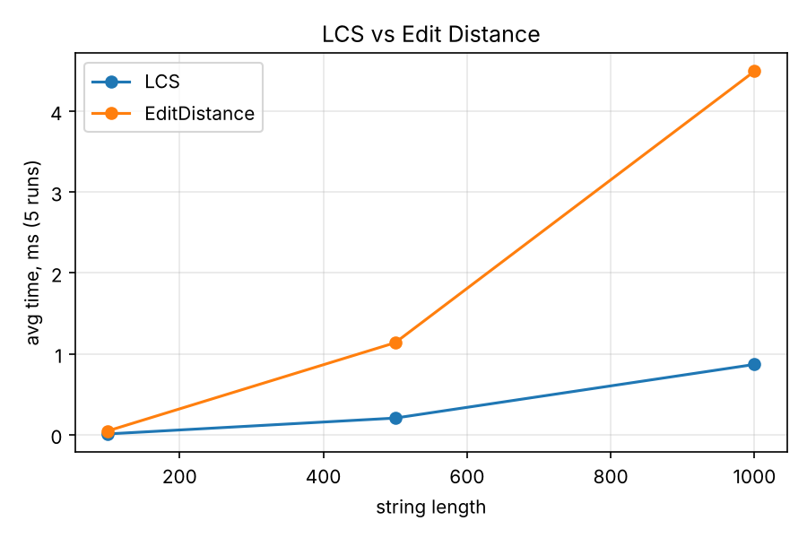
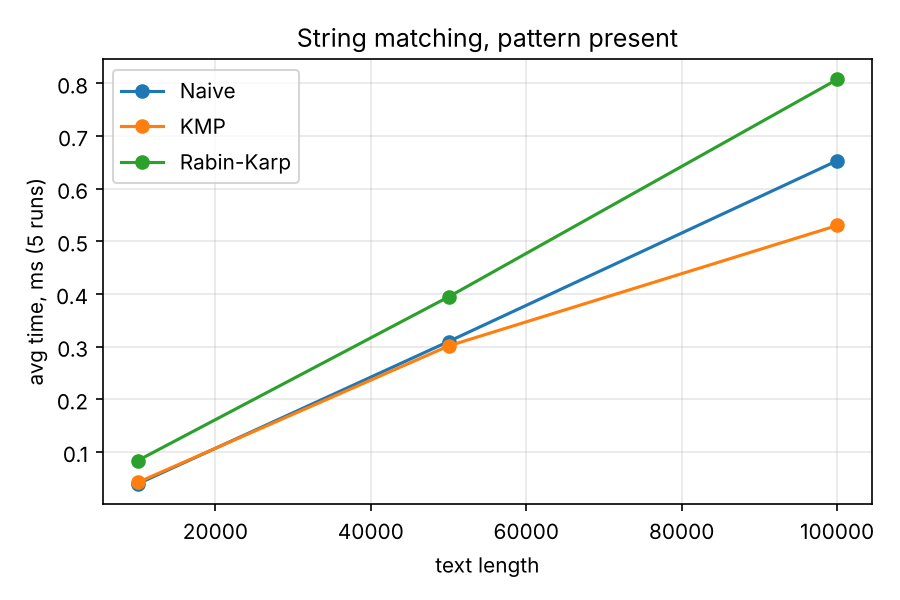
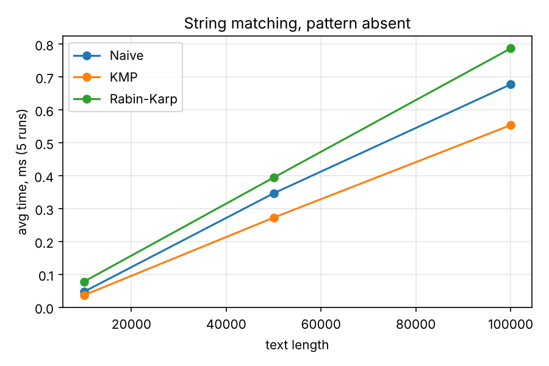
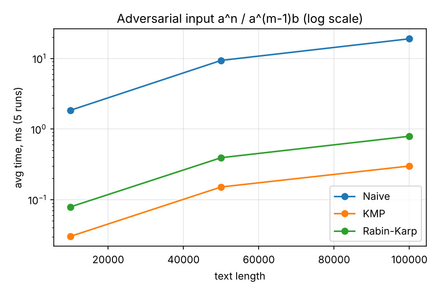
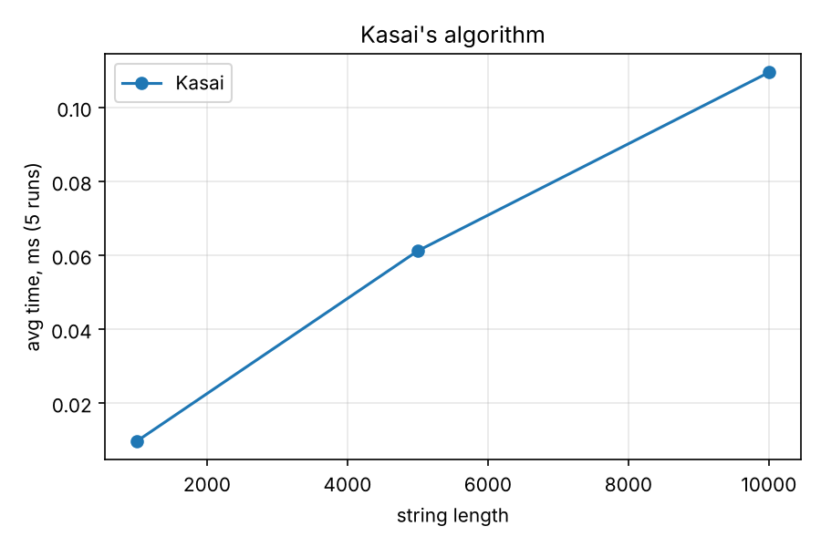

# Assignment 4 — Text Analysis: Dynamic Programming and String Algorithms


## 1. Problem description and algorithm overview

| Part | Algorithm | What it solves |
|---|---|---|
| A | LCS | Length (and one instance) of the longest subsequence common to two strings |
| A | Edit Distance | Minimum number of insertions, deletions, substitutions turning string A into B |
| B | Naive | Try every alignment of the pattern; baseline |
| B | KMP | Uses the LPS table so the text pointer never moves backwards |
| B | Rabin–Karp | Rolling hash of each text window; verifies only on hash equality |
| C | Kasai | Builds the LCP array from a string and its suffix array in linear time |

## 2. Implementation decisions and assumptions

* **Layout:** `src/textanalysis/{dp,matching,suffix,bench}`, tests in `test/textanalysis/AllTests.java`. Tests use a tiny dependency-free runner (no JUnit jar needed), so everything builds with plain `javac`.
* **Empty pattern:** every matcher returns an **empty list** (no occurrences are reported). Pattern longer than the text also returns an empty list.
* **Overlapping occurrences** are reported (`"aa"` in `"aaaa"` → `[0,1,2]`). Indices are 0-based and ascending.
* **Edit Distance** uses unit costs for insert, delete and substitute.
* **Rabin–Karp:** base 256, modulus 1 000 000 007, `long` arithmetic. A hash match is always verified character by character, so collisions never produce wrong answers; they are counted as `spuriousHits`.
* **Kasai:** `lcp[i]` = LCP of suffixes `sa[i-1]` and `sa[i]`, with `lcp[0] = 0`. The suffix array is built by a simple sort of suffixes (`SuffixArray.naive`), outside the timed region.
* **Operation counts:** character comparisons between text and pattern during search (KMP's LPS preprocessing comparisons are not included). For LCS / Edit Distance the "operations" are the n·m table cells.
* **Alphabet:** `{a, b, c, d}`, random strings from `java.util.Random` with **seed 42**.
* **Patterns:** length m = 100. *Present*: a substring taken from the middle of the text. *Absent*: a random pattern re-generated until KMP confirms it does not occur. An extra **adversarial** experiment (`a^n` text, pattern `a^99 b`) is added to show Naive's worst case.
* **Timing:** `System.nanoTime()` around the algorithm call only. Each experiment is first warmed up (≥30 runs and ≥300 ms, untimed) so the JIT compiler is finished, then run **5 times** and averaged. Input generation, suffix-array construction, correctness cross-checks and file writing are outside the timed regions. All algorithms of one comparison use the same text and pattern.

## 3. Why the recurrences / algorithms are correct

**LCS.** `L[i][j]` = LCS length of `a[0..i)` and `b[0..j)`.
`L[i][0] = L[0][j] = 0`; if `a[i-1] = b[j-1]` then `L[i][j] = L[i-1][j-1] + 1`, else `L[i][j] = max(L[i-1][j], L[i][j-1])`.
If the last characters are equal, some optimal subsequence can use them as its last pair (matching them never hurts), so we extend the answer for the shorter prefixes by 1. Otherwise at least one of the two last characters is not used by any optimal subsequence, so the answer is the better of dropping either one. Each cell only depends on already-computed cells, giving overlapping subproblems solved once.

**Edit Distance.** `D[i][j]` = minimum edits turning `a[0..i)` into `b[0..j)`.
`D[i][0] = i` (delete everything), `D[0][j] = j` (insert everything), and
`D[i][j] = min(D[i-1][j-1] + (a[i-1] != b[j-1]), D[i-1][j] + 1, D[i][j-1] + 1)`.
The last operation of an optimal edit script is either a match/substitution of the last characters, a deletion of `a[i-1]`, or an insertion of `b[j-1]`; the three terms enumerate exactly these cases, and the remaining prefix problem is independent.

**KMP.** `lps[k]` is the length of the longest proper prefix of the pattern that is also a suffix of `pattern[0..k]`. After a mismatch at pattern position `j`, the last `j` text characters equal `pattern[0..j)`, so the next possible alignment must start with a border of that prefix; the longest one is `lps[j-1]`. We continue from there without re-reading any text character. The text index `i` only increases, and `j` can decrease at most as many times as it has increased, so total work is O(n).

**Rabin–Karp.** The hash of window `s` is `Σ t[s+k]·B^(m-1-k) mod M`. Moving the window subtracts the leading character's contribution, multiplies by `B`, and adds the new character, in O(1). Equal strings always have equal hashes, so no match is missed; unequal strings may collide (probability ≈ 1/M per window for a good hash), so on every hash hit the window is compared character by character. This makes the result exact; collisions only cost time.

**Kasai.** The LCP array stores, for each position in sorted suffix order, how many leading characters the suffix shares with the previous suffix in that order (adjacent suffixes in the suffix array share the longest prefixes, and the LCP of any two suffixes is the minimum of the LCPs between them — which is why it is used for repeated substrings, longest repeated substring, counting distinct substrings, etc.). Kasai processes suffixes in text order. If suffix `i` has LCP `h` with its predecessor in sorted order, then suffix `i+1` has LCP at least `h-1` with its own predecessor (remove the first character from both). So `h` is only decremented by 1 per step and never reset, giving at most 2n increments/decrements in total.

## 4. Complexity analysis

n, m = string lengths (for matching: n = text, m = pattern, σ = alphabet size).

| Algorithm | Main operation / recurrence | Best case | Worst case | Aux. space | Justification |
|---|---|---|---|---|---|
| LCS | `L[i][j] = L[i-1][j-1]+1` or `max(L[i-1][j], L[i][j-1])` | Θ(nm) | Θ(nm) | O(nm) (O(min(n,m)) if only the length is needed) | Every cell of an (n+1)×(m+1) table is filled once in O(1) |
| Edit Distance | `D[i][j] = min(sub, del, ins)` | Θ(nm) | Θ(nm) | O(nm) (O(min(n,m)) for the distance only) | Same table shape, O(1) per cell |
| Naive | compare pattern at every shift | O(n) (first char mismatches everywhere) | O(nm) (e.g. `a^n`, `a^(m-1)b`) | O(1) | n−m+1 shifts, up to m comparisons each |
| KMP | LPS fallback `j = lps[j-1]` | O(n+m) | O(n+m) | O(m) | Preprocessing O(m); search O(n) by the amortised argument above |
| Rabin–Karp | rolling hash `h = (h − t[s]·B^(m−1))·B + t[s+m]` | O(n+m) expected | O(nm) (every window collides, or every window matches e.g. `a^n`/`a^m`) | O(1) | O(m) hash setup, O(1) per shift; verification O(m) only on hash hits. Expected time is linear because with a good hash the number of spurious hits is ≈ n/M; worst case needs adversarial collisions or many true matches |
| Kasai | `h` carried over from suffix `i` to `i+1` with `h−1` | Θ(n) | Θ(n) | O(n) (rank array + LCP output) | `h` increases at most 2n times in total because it decreases only by 1 per iteration |

Note: *Θ(n)*/*O(n+m)* are theoretical bounds on the number of basic operations. They are **not** the same as the measured times below, which also include constant factors, cache effects and JIT behaviour. Output size also matters: reporting all occurrences costs O(k) for k occurrences (for `a^n` with `a^m` this is why Rabin–Karp/KMP/Naive are all Ω(n) there).

## 5. Testing strategy and results

`test/textanalysis/AllTests.java` (run by `run.sh`; **748 checks, 0 failures**):

* **LCS:** identical strings, completely different strings, one empty string, both empty, a classic example (`ABCBDAB` / `BDCABA` → 4) and validity of the reconstructed subsequence length.
* **Edit Distance:** identical, one empty (both directions), a single substitution, insertion and deletion, and `kitten`/`sitting` = 3.
* **String matching:** pattern at beginning / middle / end, multiple and overlapping occurrences, absent pattern, pattern longer than text, empty pattern, empty text, pattern equal to the text, a KMP textbook example, and 300 random cross-checks. In **every** case Naive, KMP and Rabin–Karp must return the identical index list.
* **Kasai:** `banana` with a hand-verified suffix array `[5,3,1,0,4,2]` (suffixes `a, ana, anana, banana, na, nana`) and expected LCP `[0,1,3,0,0,2]` (`a|ana`=1, `ana|anana`=3, `anana|banana`=0, `banana|na`=0, `na|nana`=2); plus 100 random strings compared against a brute-force LCP.

## 6. Reproducing

```bash
./run.sh            # compile, run tests, run experiments, create plots (JDK 17+, Python 3 + matplotlib)
# or manually:
mkdir -p out && javac -d out $(find src test -name '*.java')
java -cp out textanalysis.AllTests
java -cp out textanalysis.bench.Benchmark   # writes results/results.csv
python3 plot.py                              # writes plots/*.png and results/tables.md
```

Machine used for the numbers below: **TODO — write your CPU / RAM / OS / Java version here and re-run `run.sh` on your own machine.**

## 7. Experimental results

Times are averages of 5 timed runs in milliseconds (after warm-up). Raw data: `results/results.csv`.

**LCS / Edit Distance**

| Algorithm | Length | Avg time (ms) |
|---|---|---|
| LCS | 100 | 0.009 |
| EditDistance | 100 | 0.047 |
| LCS | 500 | 0.205 |
| EditDistance | 500 | 1.137 |
| LCS | 1000 | 0.869 |
| EditDistance | 1000 | 4.493 |

**Kasai**

| Algorithm | Length | Avg time (ms) |
|---|---|---|
| Kasai | 1000 | 0.010 |
| Kasai | 5000 | 0.061 |
| Kasai | 10000 | 0.110 |

**String matching (random text, m=100)**

| Algorithm | Text length | Pattern | Avg time (ms) | Char comparisons |
|---|---|---|---|---|
| Naive | 10000 | present | 0.039 | 13318 |
| KMP | 10000 | present | 0.042 | 12425 |
| Rabin-Karp | 10000 | present | 0.083 | 100 |
| Naive | 10000 | absent | 0.048 | 13177 |
| KMP | 10000 | absent | 0.037 | 12537 |
| Rabin-Karp | 10000 | absent | 0.078 | 0 |
| Naive | 50000 | present | 0.310 | 66443 |
| KMP | 50000 | present | 0.301 | 61620 |
| Rabin-Karp | 50000 | present | 0.394 | 100 |
| Naive | 50000 | absent | 0.347 | 66380 |
| KMP | 50000 | absent | 0.273 | 62349 |
| Rabin-Karp | 50000 | absent | 0.394 | 0 |
| Naive | 100000 | present | 0.653 | 132851 |
| KMP | 100000 | present | 0.530 | 124338 |
| Rabin-Karp | 100000 | present | 0.807 | 100 |
| Naive | 100000 | absent | 0.678 | 133230 |
| KMP | 100000 | absent | 0.554 | 125019 |
| Rabin-Karp | 100000 | absent | 0.787 | 0 |

**String matching, adversarial (a^n, m=100)**

| Algorithm | Text length | Pattern | Avg time (ms) | Char comparisons |
|---|---|---|---|---|
| Naive | 10000 | absent | 1.844 | 990100 |
| KMP | 10000 | absent | 0.030 | 19901 |
| Rabin-Karp | 10000 | absent | 0.079 | 0 |
| Naive | 50000 | absent | 9.360 | 4990100 |
| KMP | 50000 | absent | 0.151 | 99901 |
| Rabin-Karp | 50000 | absent | 0.393 | 0 |
| Naive | 100000 | absent | 18.935 | 9990100 |
| KMP | 100000 | absent | 0.299 | 199901 |
| Rabin-Karp | 100000 | absent | 0.790 | 0 |

### Plots







## 8. Discussion: theory vs experiment

* **LCS / Edit Distance** are Θ(nm). With n = m, going from 500 to 1 000 should cost ≈4×; the measurements show growth of the same order (LCS ≈4×, Edit Distance ≈4×). Edit Distance is consistently slower than LCS by a constant factor because each cell computes a three-way minimum instead of a two-way maximum.
* **Random text:** with a 4-letter alphabet, a Naive attempt fails after about 1.33 comparisons on average, so Naive is effectively linear (≈1.3·n comparisons) and as fast as KMP; KMP needs slightly fewer comparisons (≈1.25·n) but pays for the LPS table lookups. Rabin–Karp makes almost no character comparisons (100 for the true match, 0 when absent) but must update a modular hash for every position, so it is slower here. Fewer comparisons does not mean less time: the hash arithmetic (two `%` operations per shift) costs more than a cheap character comparison.
* **Adversarial input (`a^n`, `a^99 b`):** Naive performs ≈ (n−m+1)·m comparisons (≈10⁷ for n = 100 000), and its time grows ≈ linearly with n·m (≈19 ms vs. ≈0.3 ms for KMP). KMP stays at ≈2n comparisons, and Rabin–Karp stays linear because the pattern's hash never matches. This is the practical demonstration of Naive's O(nm) worst case versus KMP's guaranteed O(n+m).
* **Rabin–Karp** is expected-linear: its worst case (many hash hits that fail verification, or true matches everywhere) was not triggered by random text; `spuriousHits` stays ≈0 with modulus 10⁹+7.
* **Kasai** time grows roughly linearly with n (0.01 → 0.06 → 0.11 ms for n = 1 000 → 5 000 → 10 000), as predicted by Θ(n). Building the suffix array dominates total cost but is deliberately excluded.
* **Caveats:** timings at the 10⁻² ms level are sensitive to JIT, GC and machine noise; the operation counts are deterministic and are the more reliable evidence of the algorithmic differences.

## 9. Conclusion — main trade-offs

* **Naive:** simplest, O(1) extra space, very good on random text, but O(nm) on repetitive input.
* **KMP:** guaranteed O(n+m) on any input at the cost of an O(m) table; best choice when worst-case guarantees or streaming (no backtracking in the text) matter.
* **Rabin–Karp:** expected O(n+m), tiny memory, and easily extended to many patterns or 2-D matching, but it has a hashing overhead per position and a (rare) quadratic worst case.
* **LCS vs Edit Distance:** same Θ(nm) time and space structure; Edit Distance does a bit more work per cell, and both can reduce memory to O(min(n,m)) when only the number is needed (at the price of not being able to reconstruct the alignment).
* **Kasai:** linear time and O(n) extra space; the preprocessing needed to get the suffix array is the real cost, but with it the LCP array enables many fast substring queries.
